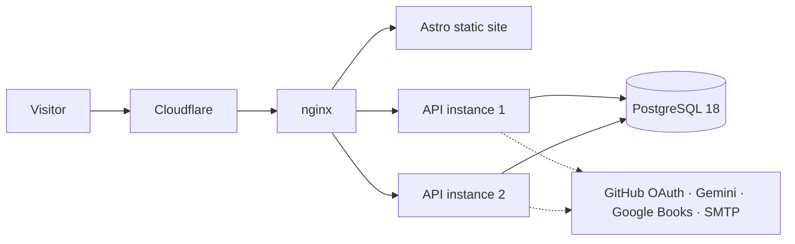

# Portfolio API

[](https://github.com/jg-abreu/portfolio-api/actions/workflows/codeql.yml)


[](LICENSE)

A static portfolio is fast, but it can't take a message, count a visit or let me update a project without a redeploy.

**Portfolio API** is the Spring Boot backend that adds those features to **[joaoabreu.dev](https://joaoabreu.dev)** while the [Astro site](https://github.com/jg-abreu/portfolio) stays static: a private admin to edit content without touching code, a contact inbox, a visit counter, an AI assistant that answers questions about me, and the live card on my [GitHub profile](https://github.com/jg-abreu).

**In production since November 14, 2026** · 2 instances behind nginx and Cloudflare · 133 tests

## Contents

- [Features](#features)
- [Architecture](#architecture)
- [Tech stack](#tech-stack)
- [Design decisions](#design-decisions)
- [HTTP overview](#http-overview)
- [Running locally](#running-locally)
- [Testing](#testing)
- [Deployment](#deployment)

## Features

| Module | What it does |
| --- | --- |
| **Admin** | Sign-in with GitHub (OAuth with PKCE), cookie sessions and CSRF-protected changes. Only my GitHub account is authorized. |
| **Projects** | Bilingual (EN/PT) drafts, a separately chosen public copy, optimistic version checks and archive/restore. |
| **Recommendations** | Bilingual drafts with categories, private image uploads and Google Books edition search. |
| **Contact** | Messages are saved before the visitor gets a confirmation, then delivered by email through an outbox with retries. Old messages are deleted after 90 days. |
| **Visits** | Approximate visit counter: one visit per visitor every 30 minutes, without storing raw IP addresses. |
| **Assistant** | Answers questions about me in English or Portuguese, using only an approved knowledge base and citing its sources (Gemini). |
| **Profile card** | The SVG card on my GitHub profile, refreshed in the background, cached and edited from the admin. |

## Architecture



Content edited in the admin is published to the site at build time: selecting a public copy queues a rebuild of the Astro site, which reads the selected projects and recommendations from this API. If a configured source fails, the build stops and the previous release stays online. See [publication](docs/publication.md).

## Tech stack

| Layer | Technologies |
| --- | --- |
| Backend | Java 21, Spring Boot 4.1 (Web MVC, Data JPA, Validation, Mail, Actuator), Spring Security with OAuth2 Client |
| Database | PostgreSQL 18, Flyway migrations |
| Integrations | GitHub OAuth and GraphQL, Google Gemini, Google Books, SMTP |
| Testing | JUnit 5, Spring Security Test, Testcontainers |
| Infrastructure | Docker Compose, nginx, Cloudflare, AWS Lightsail, CodeQL, Dependabot |

## Design decisions

- **Drafts and public copies are separate.** Saving a draft never changes the live site; publishing is an explicit choice of which version visitors see.
- **The admin is authorized by numeric GitHub ID, not username.** Usernames can change and be taken by someone else; the account ID can't.
- **Contact messages are saved first, emailed later.** The visitor's confirmation means the message is in the database. Email goes through an outbox with retries, and an `Idempotency-Key` stops a retried request from creating a duplicate.
- **Visits are counted without storing IP addresses.** The API keeps only an HMAC of the visitor's address, and behind Cloudflare it trusts `CF-Connecting-IP` only when the request comes through the known proxy chain.
- **Visitors never trigger GitHub requests.** The profile card is refreshed in the background and served from cache with ETags; if a refresh fails, the last good version stays online.
- **Everything is denied by default.** Only the routes listed below are open, and every optional feature (contact, email, visits, assistant, card) is off until configured for that environment.

## HTTP overview

| Route | Access |
| --- | --- |
| `GET /actuator/health` | Public health status |
| `GET /api/projects`, `/api/recommendations` | Selected public copies, read by the site at build time |
| `GET /api/recommendation-images/{key}` | Only images used by published recommendations |
| `GET /api/auth/csrf` | CSRF token for browser changes |
| `/api/admin/**` | Signed-in admin; changes also require CSRF |
| `POST /api/auth/logout` | Ends the session; requires CSRF |
| `POST /api/contact` | Contact form, with CSRF and a UUID `Idempotency-Key` |
| `GET /api/visits`, `POST /api/visits` | Visit counter; registering requires CSRF |
| `POST /api/assistant/messages` | Public assistant, rate limited |
| `GET /api/profile-card.svg` | Cached profile card with ETag/304 |

## Running locally

Requirements: JDK 21 and Docker with Compose (the Maven wrapper is included).

1. Create a GitHub OAuth app for local development and set these environment variables:

   | Variable | Value |
   | --- | --- |
   | `GITHUB_CLIENT_ID` / `GITHUB_CLIENT_SECRET` | From your local OAuth app |
   | `GITHUB_REDIRECT_URI` | `http://localhost:4321/login/oauth2/code/github` |
   | `SPRING_PROFILES_ACTIVE` | `local` |
   | `PORTFOLIO_ADMIN_GITHUB_ID` | Your numeric GitHub ID, if you're adapting the project |

2. Start Docker and run the API. With the `local` profile, Spring Boot starts PostgreSQL from `compose.yaml` on port 15432.

   ```sh
   ./mvnw spring-boot:run        # Windows: .\mvnw.cmd spring-boot:run
   ```

3. Run the [Astro site](https://github.com/jg-abreu/portfolio) on port 4321. It proxies the API and OAuth routes, so open the admin through the site.

Optional features are switched on with environment variables; each one is documented in [`docs/`](docs): [contact](docs/contact-delivery.md), [SMTP](docs/contact-smtp.md), [visits](docs/visits.md), [recommendations](docs/recommendations.md), [assistant](docs/assistant.md), [publication](docs/publication.md) and [profile card](docs/profile-card.md).

## Testing

```sh
./mvnw test
```

**133 tests** covering security, sessions and CSRF, HTTP limits, concurrent counter updates, stale draft versions, publication, image handling, the email outbox, scheduled cleanup and the profile card cache. Database tests run against real PostgreSQL containers with Testcontainers; external services (SMTP, Gemini, Google Books, GitHub) are simulated.

## Deployment

The production setup (Docker Compose on a 2 GB AWS Lightsail VM, nginx, two API instances and PostgreSQL) is documented in [PRODUCTION.md](PRODUCTION.md), with [backup and restore](docs/backup-restore.md) and the [two-instance test](docs/local-two-instance.md).

## License

Released under the [MIT License](LICENSE).

## Author

**João Abreu**: back-end developer and Computer Science student in Rio de Janeiro, Brazil.

Built with AI-assisted development (Claude Code). The architecture, design decisions and code reviews are mine.

[Portfolio](https://joaoabreu.dev) · [GitHub](https://github.com/jg-abreu) · [LinkedIn](https://www.linkedin.com/in/jo%C3%A3o-abreuuu)
